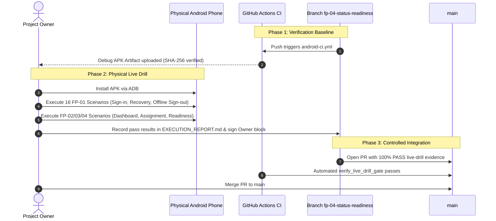

# MobiDesk — Dependency-Aware Integration Plan

**Date:** 8 November 2026
**Auditor / Architect:** Jules (AI Software Engineer)
**Governance Authority:** `AGENTS.md` & `docs/MANDATORY_LIVE_DRILL_POLICY.md`
**Purpose:** Define the precise, evidence-based sequence for integrating FP-01 through FP-04 without violating trunk isolation, gate policies, or interface compatibility.

---

## 1. Analysis of Integration Order: Logical vs Git Lineage

### 1.1 The User's Expected Logical Sequence
The Project Owner's expected conceptual dependency sequence is:
1. **FP-01:** Authentication and account recovery.
2. **FP-03:** Student-to-VM assignment resolution and authorization.
3. **FP-04:** VM lifecycle and RDP readiness contract.
4. **FP-02:** Student dashboard and workspace integration.

### 1.2 Actual Repository Git Lineage and Code Relationships
When inspecting the Git commit graph and Kotlin source files across branches, the physical branch structure reveals:
```text
main (417e7d6)
  └── fp-01-auth-hardening (13c0916) [Matches main tree identically]
        └── fp-02-student-workspace (c532be1) [Introduced UI, ViewModel, StatusRepository, ConnectPolicy, CMake cache]
              └── fp-03-assignment-resolution (aacc395) [Hardened StudentWorkspaceRepository edge cases + 6 unit tests]
                    └── fp-04-status-readiness (1cba587) [Hardened DefaultStatusRepository 403 & blank token + 2 unit tests + parser test]
```

### 1.3 Reconciliation & Findings
1. **Why FP-02 Came First in Git Lineage:**
   In early development iterations, the initial skeleton of the Student Workspace (`fp-02`) authored the prototype data models for `AssignedWorkspace` and `DefaultStatusRepository` alongside the UI composables (`MobiDeskApp.kt`).
2. **Why Logical Order Must Still Govern Acceptance:**
   Conceptually, FP-02 (the UI Dashboard) cannot function securely without:
   - Authenticated student identity (FP-01).
   - Valid, non-conflicting single VM assignment (FP-03).
   - Authoritative lifecycle and transport readiness (FP-04).
3. **Contract Containment:**
   Branch `fp-04-status-readiness` (`1cba587`) represents the **cumulative, fully hardened tip** of this entire stack. It contains:
   - All FP-01 authentication features.
   - All FP-03 hardened assignment resolution rules (`StudentWorkspaceRepository.resolve` fail-closed guards).
   - All FP-04 hardened status readiness rules (blank token fast-fail, HTTP 403 expiration).
   - The complete FP-02 Compose Dashboard UI, monotonic timer, and Connect orchestration.
   - All 63 automated unit tests passing with 0 failures.

---

## 2. Mandatory Gate Sequence Before Any Merge to `main`

Merging to `main` must strictly respect the Terminal Acceptance Invariant:
```text
FP Acceptance = (Implementation == PASS)
              ∧ (Automated Tests == PASS)
              ∧ (Build Verification == PASS)
              ∧ (Independent Code Review == PASS)
              ∧ (Physical Live Drill == PASS)
              ∧ (Project Owner Decision == ACCEPTED)
```

No PR targeting `main` can be merged while its `DEVICE_OR_ENVIRONMENT_CHECKLIST.md` contains unexecuted (`NOT RUN`) steps. The CI script `scripts/verify_live_drill_gate.py` enforces this automatically.

### Step-by-Step Gate Progression:



---

## 3. Recommended Phased Integration Plan

### Phase 1: Staging Backend & Tooling Setup
- **Objective:** Enable physical demonstration of authentication, assignment, and status.
- **Actions:**
  1. Configure staging Supabase URL and publishable key in `local.properties` (never commit keys).
  2. Deploy local staging broker instance (`session-broker`) or configure staging broker endpoint for `/v1/vm-status`.
  3. Provision 1 student account with exactly 1 assigned VM in `students` and `vms` staging tables.

### Phase 2: Live Drill Execution on `fp-04-status-readiness` Candidate
- **Candidate Branch:** `fp-04-status-readiness` @ commit `1cba5876ee163ef36d9e3cd505112fb24fb6a568`.
- **Reason:** Testing this single unified artifact demonstrates the entire integrated pipeline (FP-01, FP-03, FP-04, and FP-02) on physical hardware without multi-branch churn.
- **Test Matrix:**
  - **FP-01:** Fresh launch, invalid login, valid login, process death during recovery, duplicate deep link, offline sign-out.
  - **FP-03:** Verify single assigned VM card displays label without leaking hostname/IP; verify account with zero assignments shows safe notice; verify multiple assignments fail closed.
  - **FP-04:** Verify live lifecycle badge ("Powered on", "Starting", "Powered off") and transport badge ("Ready for Windows sign-in", "Cannot reach remote desktop service"); verify 15s monotonic freshness timer ("Updated just now" -> "Updated X seconds ago" -> "Status needs refreshing"); verify manual refresh cooldown.
  - **FP-02:** Verify Connect button is disabled when status is STOPPED or UNREACHABLE; verify Connect button becomes active when status is RUNNING + RDP_NEGOTIATION_OK or when status is stale.

### Phase 3: Evidence Recording and Owner Acceptance Sign-off
- Project Owner fills in `docs/live-drills/FP-01/EXECUTION_REPORT.md` and `docs/live-drills/FP-02/EXECUTION_REPORT.md`.
- Evidence files (redacted screenshots) recorded with SHA-256 checksums in `manifest.sha256`.
- Owner marks `Owner Decision: ACCEPTED` with alphanumeric signature in the designated block.

### Phase 4: Controlled Merge to `main`
- Merge `fp-04-status-readiness` (incorporating FP-01, FP-02, FP-03, FP-04) into `main` via PR with all gate checks passing.
- Tag milestone: `fp-01-accepted`, `fp-02-accepted`, `fp-03-accepted`, `fp-04-accepted`.
