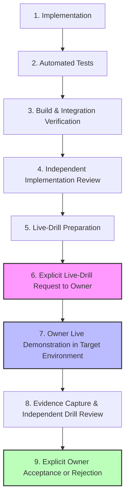

# MobiDesk — Mandatory Live Drill Acceptance Gate Policy

**Document version:** 1.0
**Effective date:** 5 November 2026
**Canonical repository:** `master43721/mobidesk-android`
**Applies to:** FP-01, FP-02, and all subsequent Feature Points (FP-01 through FP-28), including Android client, Supabase backend, Session Broker, native FreeRDP, and Dock subsystems.
**Authority:** Project Owner Directive — 5 November 2026

---

## 1. Objective and Core Principle

The MobiDesk development workflow requires that **a live feature demonstration in the relevant target environment is a mandatory, blocking acceptance gate at the end of every Feature Point (FP)**.

> [!IMPORTANT]
> **Core Invariant:** A feature point must NEVER be marked complete or accepted merely because implementation, automated tests, integration builds, and code reviews have passed. No feature point can achieve `COMPLETE` or `ACCEPTED` status without an explicit Project Owner live demonstration, documented evidence, and recorded Owner acceptance.

Mocks, unit tests, and emulators are valuable for early regression detection and developer iteration, but **they cannot substitute for the mandatory live drill** when real physical target hardware, deployed services, or target operating environments are required by the feature specification.

---

## 2. Required 9-Stage Gate Sequence

Every Feature Point (FP) must proceed through the following non-bypassable sequence in strict order:



### Stage Details

1. **Stage 1 — Implementation:**
   Source code is authored adhering strictly to parent PRD v1.2, technical design, and feature boundary constraints.
2. **Stage 2 — Automated Tests:**
   Unit tests, fake-repository integration tests, and static verification pass (100% pass rate; no ignored or skipped tests without explicit rationale).
3. **Stage 3 — Build & Integration Verification:**
   Clean standard build of the exact deployable artifact (e.g. debug APK, broker binary, Docker container) from a clean Git tree with verifiable commit SHA and artifact checksum.
4. **Stage 4 — Independent Implementation Review:**
   Independent review against PRD, security model, and quality standards confirms implementation and automated test coverage.
5. **Stage 5 — Live-Drill Preparation:**
   The agent prepares the test environment, ensures staging data is seeded, populates `docs/live-drills/FP-XX/DEVICE_OR_ENVIRONMENT_CHECKLIST.md`, and prepares the exact installation/run instructions.
6. **Stage 6 — Explicit Live-Drill Request to Owner:**
   The agent MUST formulate and send the explicit handoff message to the Project Owner (see Section 4 for exact phrasing) and **immediately STOP and wait** for the Owner's interaction results.
7. **Stage 7 — Owner Live Demonstration in Target Environment:**
   The Project Owner executes the live demonstration using the physical device, real staging broker, Windows VM, or hardware target.
8. **Stage 8 — Evidence Capture & Independent Drill Review:**
   Results, observations, screenshots, logs, or recordings are captured into `docs/live-drills/FP-XX/EXECUTION_REPORT.md` and `DEFECTS.md`. An independent review verifies that all mandatory scenarios passed and evidence meets privacy standards.
9. **Stage 9 — Explicit Owner Acceptance or Rejection:**
   The Project Owner records the definitive verdict: `ACCEPTED` or `REJECTED`. If rejected or defects are found, the FP transitions to `FAIL` or `BLOCKED` for remediation.

---

## 3. Mandatory State Model (`LIVE_DRILL_STATUS`)

Every Feature Point in progress tracking and feature packages must maintain the explicit status field:

`LIVE_DRILL_STATUS`

### Allowed Values and State Rules

| State | Definition | Gate Rule |
|:---|:---|:---|
| `NOT REQUESTED` | Implementation or prerequisite stages (1–4) are still underway; drill has not been requested. | **Blocks FP completion.** Initial default state for all new FPs. |
| `NOT READY` | Implementation or review is incomplete, build is failing, or test environment/artifact is unprepared. | **Blocks live-drill request.** Agent must not hand off. |
| `READY FOR OWNER` | Artifact is built, SHA/checksum verified, environment ready, scenario checklist prepared, and handoff sent. | Agent has handed off and is actively waiting for Owner execution. |
| `IN PROGRESS` | Project Owner is currently executing scenarios in the target environment. | Transient state during active live demonstration. |
| `PASS` | All mandatory live scenarios passed with verifiable physical/live evidence captured in `docs/live-drills/FP-XX/`. | Prerequisite for Owner acceptance. Does NOT equal `ACCEPTED` without Owner sign-off. |
| `FAIL` | One or more mandatory live scenarios failed, or regression/crash occurred. | Requires all defects and failed criteria to be documented in `DEFECTS.md`. Blocks acceptance. |
| `BLOCKED` | External dependency, hardware unavailability, build blocker, or environment failure prevents running the drill. | Requires specific blocker ID and next remediation action documented. Blocks acceptance. |
| `NOT RUN` | Live drill scenarios have been catalogued but have not yet been executed. | **Never equivalent to PASS.** Blocks acceptance. |

### Terminal Acceptance Invariant

```
FP Completion = (Implementation == PASS)
              AND (Automated Tests == PASS)
              AND (Build Verification == PASS)
              AND (Independent Review == PASS)
              AND (LIVE_DRILL_STATUS == PASS)
              AND (Project Owner Decision == ACCEPTED)
```

---

## 4. Mandatory Agent Request Protocol & Stop Rule

When Stages 1 through 4 pass, the AI agent **MUST NOT** assume the feature is complete. The agent **MUST** send an explicit live-drill handoff request to the Project Owner.

### Required Handoff Phrasing

The agent must output the following structured notification:

> **"FP-XX is ready for its mandatory live drill. Here is the exact artifact, source SHA, test environment, installation/setup procedure, scenario checklist and expected outcomes. Please perform the live drill."**

### Accompanying Handoff Package

The handoff request must provide:
1. **Target Feature:** FP-XX and title.
2. **Source Reference:** Exact Git branch and commit SHA.
3. **Artifact Reference:** Path to artifact, build command, and SHA-256 hash.
4. **Target Environment:** Exact physical device model, OS version, or deployed service endpoint.
5. **Setup Procedure:** Step-by-step installation instructions (e.g. ADB install, local properties).
6. **Scenario Checklist:** Link to `docs/live-drills/FP-XX/DEVICE_OR_ENVIRONMENT_CHECKLIST.md`.
7. **Expected Outcomes:** Concrete pass criteria for each scenario.
8. **Stop Notice:** Explicit notice that the agent is stopping to await the Owner's demonstration results.

### Non-Negotiable Agent Rules

- **Do NOT wait** for the Project Owner to remember to ask for a demonstration.
- **Do NOT silently skip** the handoff or proceed to the next feature point.
- **Do NOT mark** the feature accepted because automated tests passed or because the agent generated a report.
- **STOP execution immediately** after transmitting the live-drill request.

---

## 5. Environment Matching by Feature Type

The live demonstration must be executed against the actual target runtime environment required by the feature:

| Feature Type | Target Environment | Minimum Live Drill Requirement | Prohibited Substitutions |
|:---|:---|:---|:---|
| **Android UI / Auth** (e.g. FP-01) | Physical Android Phone (SDK 29–37) | Install release/debug APK on physical phone; touch interactive screens; test real cold-start, deep-link callback, process death, and sign-out. | Emulators or Compose desktop previews cannot replace physical touch and deep-link lifecycle. |
| **Dashboard / Status** (e.g. FP-02, FP-03, FP-04) | Physical Phone + Real Staging Broker API | Exercise actual Android UI against approved broker staging API and real student assignment data; verify real lifecycle state rendering and fresh/stale transitions. | Mock HTTP engines or hardcoded state fakes cannot replace live broker endpoint checks. |
| **Session Broker** (e.g. FP-06, FP-07) | Deployed Test Broker Instance | Execute authenticated API requests, JWT validation, one-use grant consumption, and revocation against the live service. | Local loopback mock without real database RLS or networking cannot replace service verification. |
| **FreeRDP / Session** (e.g. FP-08 through FP-18) | Physical Android Phone + Approved Windows Test VM | Connect over secure WSS relay from physical phone client to real Windows VM; perform NLA auth; exercise interactive remote session, audio/input, and disconnect. | Mock RDP socket or simulated frame renderer cannot replace real FreeRDP native protocol session. |
| **Dock Hardware** (e.g. FP-19 through FP-22) | Raspberry Pi 5 / Physical Display Hardware | Connect physical phone to hardware dock; demonstrate real HDMI external display output, USB mouse/keyboard input, and display-switch lifecycle. | Simulated external displays or software frame-grabbers cannot replace physical dock hardware. |

---

## 6. Evidence and Directory Standard

Every Feature Point must maintain an isolated evidence directory:

```
docs/live-drills/FP-XX/
├── EXECUTION_REPORT.md
├── DEVICE_OR_ENVIRONMENT_CHECKLIST.md
├── DEFECTS.md
└── evidence/
    └── README.md (indexes redacted screenshots, session logs, or recordings)
```

### File Responsibilities

1. **`EXECUTION_REPORT.md`:**
   - Executive summary and feature boundaries.
   - Exact source commit SHA and artifact SHA-256.
   - Execution date, operator, and verification agent.
   - Requirements reconciliation matrix mapping each functional requirement to unit tests and live scenarios.
   - Environment and tooling verification.
   - Current `LIVE_DRILL_STATUS` and explicit Owner decision (`ACCEPTED` / `REJECTED` / `AWAITING DEMONSTRATION`).
2. **`DEVICE_OR_ENVIRONMENT_CHECKLIST.md`:**
   - Preflight environment verification (device model, Android OS, build variant, network).
   - Step-by-step scenario matrix with explicit actions, expected results, observed outcomes, and scenario status (`PASS`, `FAIL`, `BLOCKED`, `NOT RUN`).
3. **`DEFECTS.md`:**
   - Formal defect log tracking each anomaly discovered during build, preflight, or live drill.
   - Defect ID, severity, discovered stage, root cause analysis, and proposed resolution.
   - Rule: **Never silently fix a defect during a live drill and report the original drill as PASS.** Document in `DEFECTS.md` first.
4. **`evidence/`:**
   - Storage for redacted media, terminal logs, or test captures.

### Strict Privacy and Redaction Standards

All live-drill evidence must comply with the following redaction mandates:
- **NEVER record or store:** Passwords, Supabase bearer/access tokens, refresh tokens, recovery magic links, PKCE code verifiers, Supabase service-role keys, private IP addresses, internal hostnames, student personal data (real names, emails, student IDs), or private remote desktop contents.
- Use only synthetic staging accounts (`qa-student@example.edu`) or redact personal information prior to check-in.

---

## 7. Defect Handling and Stop Rules

If a defect or unexpected behavior occurs during the live demonstration:
1. **Immediately halt the drill.** Do not proceed to later steps that depend on the failed behavior.
2. Record the defect in `docs/live-drills/FP-XX/DEFECTS.md` with complete reproduction steps.
3. Transition `LIVE_DRILL_STATUS` to `FAIL` (if defect breaks scenario) or `BLOCKED` (if external failure stops execution).
4. Request explicit Owner direction before applying any source or configuration fixes.
5. After the fix is reviewed and merged, re-run all regression tests and restart the live drill from Stage 5.

---

## 8. Historical Reconciliations

- **FP-01 (Authentication & Recovery):** Automated unit tests passed (39/39). Build and live drill currently gated on DEF-001 (FFmpeg linker OOM) and DEF-002 (missing Supabase publishable key). Status: `LIVE_DRILL_STATUS: BLOCKED`. Owner acceptance: `NOT ACCEPTED`.
- **FP-02 (Student Dashboard):** Specification v0.1 merged, v0.2 under review. Implementation not started. Status: `LIVE_DRILL_STATUS: NOT REQUESTED`. Owner acceptance: `NOT ACCEPTED`.
