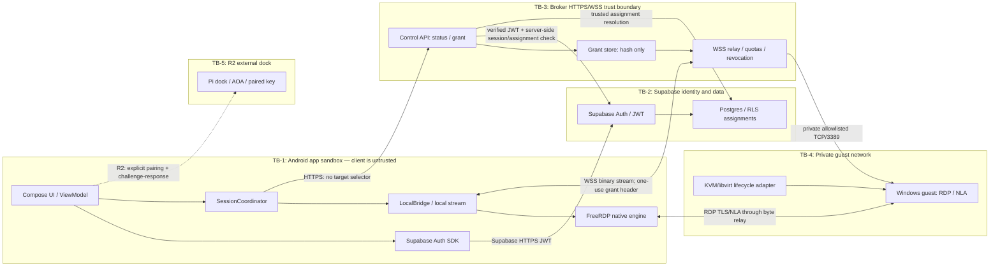

# MobiDesk — Security Threat Model

**Version:** 1.0 · **Date:** 3 November 2026  
**Normative baseline:** MobiDesk PRD v1.2, especially §§3, 6, 8, 9, 10, 12 and 13.  
**Status:** R1 threat model for G1 review; controls below are requirements/design, not evidence of deployed protection.

## 1. Security objectives

1. A student can connect only to the single VM currently assigned to that authenticated Supabase identity.
2. A client cannot choose the VM, host, IP or port.
3. Revoked or reassigned sessions stop carrying RDP traffic within 30 seconds.
4. The Windows guest credential is separate from Supabase and remains transient on the Android device.
5. RDP server identity is validated; no trust-all or accept-any override exists.
6. The local FreeRDP transport cannot be claimed by another local application.
7. The broker has bounded resource use and resists replay, enumeration and exhaustion.
8. Logs and telemetry do not disclose credentials, grants, JWTs, student identity, VM endpoints or screen contents.
9. Dock authentication is cryptographic in R2; USB/AOA descriptors are not identity.
10. The pinned FreeRDP build is reviewed against upstream security advisories before pilot release.

## 2. Assets, principals and security assumptions

### Assets
- Supabase access JWT and refresh/session state.
- Authenticated subject, session_id and student-to-VM assignment.
- One-use MobiDesk grant and its server-side hash/metadata.
- Windows NLA username/domain/password held transiently by the Android client.
- RDP TLS certificate identity and broker-approved trust policy.
- RDP byte-stream confidentiality/integrity in transit.
- Broker availability, per-user session slot and server-only VM allowlist.
- Windows guest workload/data and guest account security.
- Audit/telemetry data and operational signing/trust configuration.
- Future dock pairing key (R2 only).

### Principals
- Student using the Android client.
- Project Owner / operator.
- Lab IT operator.
- Supabase Auth and Postgres/RLS.
- MobiDesk control broker and relay broker.
- KVM/libvirt host and Windows guest.
- FreeRDP native protocol engine.
- Future Raspberry Pi dock (R2).

### Explicit assumptions / limits
- **[VERIFIED: `README.md` at `main@5979320`]** The current app is a native Kotlin/Jetpack Compose client; current RDP integration is not complete.
- **[VERIFIED: `.gitmodules` and gitlink at `main@5979320`]** FreeRDP is pinned at `d27a4f7c1c63b62a5e60e5d939ad116cfb58ffc1`; the upstream commit identifies itself as release 3.32.0.
- **[VERIFIED: `app/src/main/AndroidManifest.xml` at `main@5979320`]** Current manifest disables cleartext traffic.
- **[UNKNOWN]** A physical RD-1 Pixel 6 is not verified as available for security tests.
- **[UNKNOWN]** Exact FreeRDP raw-stream injection, callback and local descriptor APIs have not yet been proven against the pinned source.
- **[UNKNOWN]** The active-session lookup implementation and its minimum Supabase privilege path are not yet deployed.
- The Android client is an untrusted endpoint. Root/integrity checks are defense-in-depth, not the primary authorization boundary.
- The broker is trusted to enforce assignment and private egress restrictions; compromise of the broker or its allowlist is a high-impact residual risk.
- Windows NLA terminates at the VM through the encrypted RDP stream. The broker is a byte relay and cannot inspect guest passwords.

## 3. Trust boundaries

The broker is the only authorized component that resolves a student assignment to a routable guest endpoint. The RDP TLS/certificate check is a separate security layer from WSS TLS between Android and broker.

## 4. STRIDE analysis by component

| Component / boundary | Spoofing | Tampering | Repudiation | Information disclosure | Denial of service | Elevation of privilege |
|---|---|---|---|---|---|---|
| Android client / UI | Stolen Auth token; fake app/client | Client modifies requests or local state | User disputes connect/disconnect | Tokens/passwords in Intent, logs or screenshots | Repeated connect, large input or app lifecycle churn | Rooted device hooks client; modified app bypasses UX restrictions |
| Supabase Auth / JWT | Forged, expired or wrong-issuer JWT | Token/session metadata tamper | No audit of auth/session events | Refresh/access token disclosure | Auth endpoint throttling/outage | Service-role key embedded in app; misuse of privileged API |
| Postgres / RLS assignment | Spoofed subject or role | Assignment row changed or duplicated | Assignment changes not attributable | Cross-student reads or VM metadata leak | Expensive assignment query | RLS bypass or SECURITY DEFINER privilege abuse |
| Broker control API | Caller spoofing, invalid JWT | Client-supplied target selector | Grant denial/approval not audited | Error reveals account/VM existence | Grant/status floods | Weak server authorization or secret exposure |
| Grant store / session slot | Replay/stolen grant | Binding/expiry/hash mutation | Consume/revoke event missing | Raw grant disclosed | Unbounded grant state or race allocations | Reuse grants across users/assignments |
| WSS relay | Grant theft or replay | Frame/order corruption; stream injection | Relay start/end not recorded | RDP bytes or endpoint exposed | Relay exhaustion, queue growth, slow consumer | Relay selects arbitrary endpoint or arbitrary TCP forwarding |
| LocalBridge | Another local app claims listening port | Bytes injected into FreeRDP stream | Local client identity absent | Local secret or stream capture | Port scan/connection flood | Peer impersonation or bypass of local authentication |
| FreeRDP native engine | Malicious server/guest impersonates RDP peer | Malformed RDP PDUs / certificate callback bypass | Client security event absent | Credential, frame or clipboard exposure | Parser/decoder crash, oversized graphics or CPU exhaustion | Native memory corruption / applicable vulnerability |
| Windows guest | Fake guest endpoint | Malicious guest sends malformed protocol/data | Failed logons not monitored | Student files/data exposed | Guest overload or account lockout | Guest compromise pivots into lab network |
| R2 dock | Spoofed AOA descriptors | Display/input stream substitution | Pair/unpair event missing | Desktop frames sent to wrong dock | Dock disconnect/power loss | Unauthorized dock accepts keyboard/input |
| Operations / signing | Fake operator or key | Wrong pin/config or release artifact altered | Changes lack owner record | Keystore, pin inventory or logs leaked | Bad config prevents broker startup | Release key compromise or unauthorized VM allowlist update |

## 5. Abuse cases and required controls

### SEC-01 — Client selects another student's VM

**Attack:** Modify the status/grant request with a guessed VM ID, endpoint, hostname or user identity.

**Controls:**
- Control requests have no target selector; unknown body properties are rejected.
- Validate JWT issuer/audience/signature/expiry/session_id.
- Resolve exactly one assignment using the authenticated subject and trusted server-side data.
- Map assignment to an explicit owner-approved endpoint allowlist; fixed upstream port 3389.
- Zero, duplicate, inactive or unmapped assignments fail closed. VM4 remains excluded until verified.
- Return generic/PRD-mapped denial and no private endpoint or other student's data.

**PRD mapping:** §§3.1, 6.3, 6.5, 9 items 1–2, 5, 10, FR-VM-01–03, NFR-SEC-01.  
**Required tests:** SEC-T01 no-target contract; SEC-T02 cross-student JWT; SEC-T03 zero/duplicate assignment; SEC-T04 unmapped/VM4; SEC-T05 allowlist tamper.

### SEC-02 — Local socket hijack / rogue Android app

**Attack:** A second app scans localhost, claims the bridge port before FreeRDP connects, injects bytes or consumes the one allowed connection.

**Controls (preferred order):**
1. Socketpair or connected descriptor passed to FreeRDP if the pinned v3.32.0 Android/native API safely supports it.
2. App-private Unix-domain socket with restrictive permissions and same-UID peer verification when supported.
3. Loopback TCP only if exact pinned-client APIs support a secret-bearing handshake that the legitimate FreeRDP side can prove. Use a high-entropy one-time secret, bind only to 127.0.0.1, open listener immediately before the expected connect, accept exactly one peer, verify it, close the listener immediately, enforce a short deadline and clear the secret.
4. A random port alone is not authentication. If the FreeRDP client cannot participate in a protected handshake, stop; do not ship an unauthenticated bridge.

**Concurrency / byte handling:** dedicated bounded reader/writer workers; one ordered byte stream in each direction; finite queues; pause reads at high-water; handle EOF, half-close, cancellation, timeout and process teardown; never allow unbounded buffering.

**PRD mapping:** §6.6, §9 item 6, FR-RDP-05.  
**Required tests:** SEC-T06 socketpair/Unix peer check; SEC-T07 hostile same-device app attempts to bind/consume/inject; SEC-T08 listener single-accept closure; SEC-T09 byte fidelity under arbitrary frame segmentation; SEC-T10 queue saturation/backpressure/EOF/half-close.

### SEC-03 — Grant theft, replay and concurrent consume

**Attack:** Steal the grant from memory/logs, replay after use/expiry, race two consumers, or use it from a different user/session/assignment.

**Controls:**
- Minimum 256 bits of CSPRNG entropy; <=60-second TTL.
- Store only a cryptographic hash; return the raw secret once.
- Bind to subject, active Auth session_id, assignment/version and server-resolved VM.
- Atomic one-time consume; only the winner allocates a relay.
- Authorization header only; never URL/query, analytics, crash report or persistent client storage.
- On every grant failure map to PRD GRANT-01/02; generic outward denial; audit safe reason code.
- New connection/reconnect always requests a new grant.

**PRD mapping:** §6.3, §9 item 4, FR-SES-01/02, NFR-SEC-01.  
**Required tests:** SEC-T11 entropy/TTL/hash review; SEC-T12 replay; SEC-T13 concurrent consume race; SEC-T14 cross-user/session/assignment; SEC-T15 URL/log redaction; SEC-T16 grant rotation and reconnect.

### SEC-04 — Session revocation window

**Attack:** Student signs out, account is disabled, token is revoked, or assignment changes while JWT remains cryptographically valid until expiry; an existing relay continues.

**Controls:**
- Verify active Supabase session state keyed by JWT `session_id` during grant issuance.
- Verify assignment at grant issuance and before relay open.
- Re-check both session and assignment every <=15 seconds during active relay (or push invalidation plus bounded polling fallback).
- Close relay and upstream socket within <=30 seconds after revocation/change.
- Fail closed if session-state source is unavailable.
- Phone sign-out alone is not a server revocation guarantee.

**PRD mapping:** §6.3, §6.5, §9 item 3, FR-SES-03, FR-LIFE-02, NFR-SEC-01.  
**Required tests:** SEC-T17 revoke before grant; SEC-T18 revoke during relay; SEC-T19 change assignment during relay; SEC-T20 session-state backend timeout; SEC-T21 measure <=30-second termination.

### SEC-05 — Account/assignment enumeration

**Attack:** Probe status/grant routes to discover valid users, assignment count, VM availability or which accounts map to VM4.

**Controls:**
- Bind queries to verified caller subject; do not accept a requested student/user ID.
- Use generic safe errors and avoid exposing internal lookup results/IDs/endpoints.
- Rate-limit status and grant requests per user and source.
- Apply consistent response shape and avoid materially distinct timing where practical.
- Audit repeated denials using opaque request IDs; never put another user's data in diagnostics.

**PRD mapping:** §9 items 2, 4, 12, FR-VM-03, NFR-SEC-01.  
**Required tests:** SEC-T22 response schema equality; SEC-T23 error/timing differential review; SEC-T24 rate-limit probing; SEC-T25 confirm private IDs never returned.

### SEC-06 — Relay exhaustion and broker DoS

**Attack:** Open many sessions, send large WebSocket frames, create slow consumers, hold sockets idle, force repeated TCP probes, or consume grant slots.

**Controls:**
- Five grant requests/minute/user for R1.
- One active relay per student; bounded pilot-wide capacity, not more than approved VM capacity.
- 1500 ms readiness probe budget.
- Proposed bounded WebSocket frame, queue, connect, idle, ping/pong and maximum-session limits in API_CONTRACT.md.
- Apply queue backpressure; close slow consumers rather than buffer indefinitely.
- Atomic capacity reservation/release and orphan cleanup.
- Global distributed limits if broker has multiple replicas; process-local counters alone are insufficient.
- Generic denial; bounded exponential client retry with jitter; no automatic retry loops.

**PRD mapping:** §§6.3, 6.5, 6.6, 9 items 4–5, FR-SES-04, NFR-PERF-05.  
**Required tests:** SEC-T26 rate limit; SEC-T27 concurrency cap; SEC-T28 oversized frame/text-frame; SEC-T29 queue high-water/slow reader; SEC-T30 idle/ping/pong/connect timeout; SEC-T31 status probe timeout and load; SEC-T32 broker restart/orphan slot cleanup.

### SEC-07 — RDP certificate substitution or unsafe rotation

**Attack:** DNS/network attacker, compromised route or malicious guest presents an unexpected RDP server certificate; user accepts a spoofed warning.

**Controls:**
- Broker grant carries the exact approved per-VM leaf certificate SHA-256 pin or an explicitly approved internal-CA fingerprint policy.
- Validate at the guest-facing RDP TLS handshake in FreeRDP; the broker byte relay does not terminate guest RDP TLS.
- No trust-all FreeRDP preference, permissive callback, user accept-any prompt or debug-only bypass reachable in release.
- Pin source is trusted and grant-bound; client may not submit a different pin.
- Lab IT verifies new fingerprint out-of-band. Overlap old/new trust only during approved rotation window; verify new chain then remove old trust; maintain rollback record.
- Missing, expired, unknown or mismatched pin hard-fails and maps RDP-CERT-01.

**PRD mapping:** §§6.7, 9 items 7, 11, FR-RDP-02, FR-SEC-04? (root is FR-SEC-04; certificate is its own RDP requirement), NFR-SEC-01.  
**Required tests:** SEC-T33 valid pin; SEC-T34 changed certificate; SEC-T35 expired/untrusted cert; SEC-T36 missing pin; SEC-T37 rotation overlap/cutover/rollback; SEC-T38 static scan trust-all configuration.

### SEC-08 — Credential disclosure and Windows account abuse

**Attack:** Windows NLA credentials leak into Intent/Bundle, saved state, preferences, database, clipboard, logs, crash data or telemetry; brute force or account enumeration against a guest.

**Controls:**
- Separate per-student Windows account, not Supabase password.
- Native prompt before grant; password never goes to broker.
- Store in volatile mutable buffers; minimize copies; do not save in Intent, Bundle, URI, SavedStateHandle, preferences, Room, clipboard, crash report or log.
- Clear app-owned mutable and native copies after FreeRDP has copied/consumed credentials and on NLA success/failure/cancel/disconnect/process teardown. Managed-runtime immutable Strings cannot be promised securely erased; avoid creating them where API permits.
- Rate-limit guest-auth retry locally. Do not reveal whether username exists.
- Lab IT defines lockout threshold, monitoring and account reset. Broker cannot inspect NLA credentials as a byte relay.

**PRD mapping:** §§6.4, 9 items 3, 8, 13, FR-GUEST-01/02, NFR-PRIV-01.  
**Required tests:** SEC-T39 credentials absent from persistent storage; SEC-T40 Intent/Bundle/saved-state inspection; SEC-T41 Logcat/crash/analytics scan; SEC-T42 memory/native lifecycle review; SEC-T43 wrong-user/password and retry lockout behavior.

### SEC-09 — Rooted/unlocked device and app tampering

**Attack:** Attacker modifies client logic or hooks APIs to bypass UI restrictions, extract tokens, suppress certificate checks or intercept local bytes.

**Controls:**
- High-confidence rooted or unlocked-bootloader signal blocks Cloud PC session in R1.
- Integrity check unavailable/indeterminate is UNKNOWN, never CLEAN; follow PRD policy and block under unsupported policy.
- Client integrity checks are defense-in-depth only. Broker-side JWT, assignment, grant and revocation checks are authoritative.
- No trust-all or endpoint bypass should be possible through debug preference in a release build.
- Use FLAG_SECURE on RDP Activity; document that it reduces normal capture paths but cannot stop a fully compromised OS.

**PRD mapping:** §9 items 9–11, FR-SEC-04, NFR-SEC-01.  
**Required tests:** SEC-T44 rooted device block; SEC-T45 unlocked bootloader block; SEC-T46 unknown integrity maps to UNKNOWN and blocks; SEC-T47 release config cannot disable certificate policy; SEC-T48 screenshot/recents FLAG_SECURE.

### SEC-10 — Spoofed dock identity (R2 only)

**Attack:** A malicious USB device reports the expected Android Open Accessory manufacturer/model/serial strings and receives desktop frames or injects input.

**Controls:**
- AOA/USB strings are discovery metadata only, not authentication.
- Require explicit student confirmation for first pairing or changed dock key.
- Each dock gets a provisioned private key or high-entropy device secret protected by hardware-backed storage where available.
- Perform mutual challenge-response; bind the paired identity, user and session; support revoke/unpair and key rotation.
- Do not stream frames or allow reverse input until authentication succeeds.
- Dock UX/implementation remains R2; do not imply the R1 client already authenticates docks.

**PRD mapping:** §4.2, §9, FR-DOCK-01/02.  
**Required tests:** SEC-T49 spoofed AOA descriptors rejected; SEC-T50 failed challenge response; SEC-T51 replay challenge; SEC-T52 unpair/revoke; SEC-T53 changed key/new confirmation.

### SEC-11 — Malicious or compromised Windows guest

**Attack:** The guest sends malformed or oversized RDP graphics/input/channel data, attempts clipboard/file-channel exfiltration, or uses a compromised session to attack the client/broker.

**Controls:**
- Keep the broker a byte relay with no guest-supplied arbitrary forwarding or command execution.
- Native FreeRDP parsers/codecs process untrusted network data; use bounded frames/buffers, current patched upstream release, and exact version review before release.
- R1 excludes clipboard/file transfer, audio and arbitrary channel forwarding unless separately threat-modelled and approved.
- Windows guest accounts are least-privilege and separated per student; Lab IT maintains patch, Defender/EDR and failed-logon policy.
- Crash/decoder failure closes the session, clears transient credentials and releases slots.
- No guest endpoint can influence the broker allowlist or issue hypervisor commands.

**PRD mapping:** §§4.1, 6.6, 9 items 13–14, 10, FR-RDP-01/05, FR-LIFE-03, FR-REL-02.  
**Required tests:** SEC-T54 malformed/oversized RDP data fault injection; SEC-T55 excluded channel inspection; SEC-T56 guest compromise isolation review; SEC-T57 least-privilege guest audit; SEC-T58 FreeRDP dependency/advisory report.

### SEC-12 — FreeRDP vulnerability or unreviewed dependency

**Attack:** A known vulnerable pinned library is used in a release, or an unreviewed dependency update changes native protocol/security behavior.

**Controls:**
- Verify exact submodule commit/version and produce an SBOM/dependency inventory at release.
- Review upstream FreeRDP security advisories and applicable CVEs for the exact pinned version before R1 release. Do not claim the pinned version is vulnerability-free without a dated scan.
- No unreviewed high/critical applicable advisory may remain open at release, per PRD §9 item 14.
- Upgrade only through a reviewed source/dependency change with ABI, build, rendering, TLS/NLA, callback, transport, and regression verification.
- Preserve dependency provenance and the tested gitlink in release evidence.

**PRD mapping:** §6.1, §9 item 14, FR-RDP-01, FR-REL-01.  
**Required tests:** SEC-T59 SBOM output; SEC-T60 dated advisory/CVE review; SEC-T61 ABI/package regression after any upgrade; SEC-T62 exact gitlink recorded in tested artifact evidence.

### SEC-13 — Logs, telemetry and audit disclosure

**Attack:** JWT, grant, password, private host/endpoint, student name/email or desktop pixels appear in logs, metrics, crash reports, traces or support exports.

**Controls:**
- Allowlist telemetry fields, not denylist-only filtering.
- Log opaque request/session correlation, stage, duration, safe PRD code, outcome and coarse capacity/network bucket only.
- Never log Authorization headers, grant values/hashes, passwords, RDP payload, VM UUID/address/hostname, screen content or direct student identifiers.
- Redact at client, broker, reverse proxy, crash reporter and CI artifact boundaries.
- Role-limit access; approve retention; test export redaction.

**PRD mapping:** §9 items 8, 12, FR-OBS-01, NFR-PRIV-01.  
**Required tests:** SEC-T63 source/static secret scan; SEC-T64 Logcat/server log/trace scan; SEC-T65 proxy access log scan; SEC-T66 telemetry schema validation; SEC-T67 packet capture review.

## 6. Residual risks and release conditions

| Residual risk | Why it remains | Required treatment before release |
|---|---|---|
| Compromised broker or privileged allowlist | Broker controls which private VM is reachable | Protect server secrets; least privilege; owner-only audited allowlist changes; deployment review |
| Android OS/root compromise | Local root can observe app memory and screen | Block high-confidence root/unlocked; treat local checks as defense-in-depth; disclose residual risk |
| Managed-runtime secret copies | JVM/Kotlin immutable objects cannot guarantee secure erasure | Avoid copies; use mutable buffers/native lifecycle; minimize lifetime; review actual FreeRDP API |
| FreeRDP CVE exposure | Native protocol engine parses untrusted peer data | Dated advisory/SBOM review; patched version if needed; regression test |
| Windows guest compromise | Guest is the RDP peer and handles student workload | Least-privilege accounts, guest patching/monitoring and isolation by Lab IT |
| TLS trust rotation error | Pin/CA change can cause outage or wrong trust | Owner-approved two-phase rotation, out-of-band verification and rollback |
| Local bridge API incompatibility | Pinned Android client may not accept protected descriptor/socket | G3 blocker until pinned-source spike and hostile-local-client test pass |
| Supabase revocation adapter | Active session query path and permissions require validation | No grant/release until query works and <=30 sec termination is demonstrated |
| Dock key compromise (R2) | Physical dock key may be extracted or replaced | Key lifecycle, revocation, pairing confirmation; R2 threat test |

### Security release stop conditions

Stop release or pilot expansion if any of these occur:
- unauthorized/cross-student session succeeds;
- assignment/client target changes route the broker;
- active revoked session remains relaying beyond 30 seconds;
- RDP certificate missing/mismatch is accepted;
- a local app can hijack the FreeRDP bridge;
- public TCP/3389 is reachable or the broker allows arbitrary destination forwarding;
- any credential, grant, JWT, student identifier, private endpoint or screen content appears in logs/telemetry;
- applicable high/critical FreeRDP advisory remains unresolved;
- any grant/session/relay/native worker/socket leaks after teardown.

Do not mitigate by exposing public RDP, disabling certificate verification, suppressing root/integrity state, accepting unverified VM4, or silently moving the student's assignment.

## 7. Evidence and ownership

- Project Owner is accountable for security acceptance and release decisions.
- Lab IT is consulted for Windows guest accounts/lockout, VM isolation, endpoint and certificate provisioning, retention and backup.
- Every SEC-Txx case is recorded in `TEST_PLAN.md` and `PROGRESS.md` with branch/commit, device or server class, exact method, result and evidence hash/link.
- No production PII, private endpoint, credential or signing material belongs in the test evidence committed to Git.
